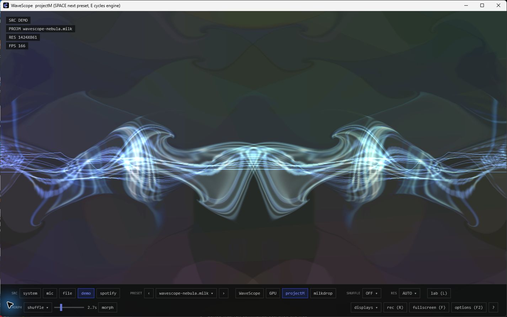
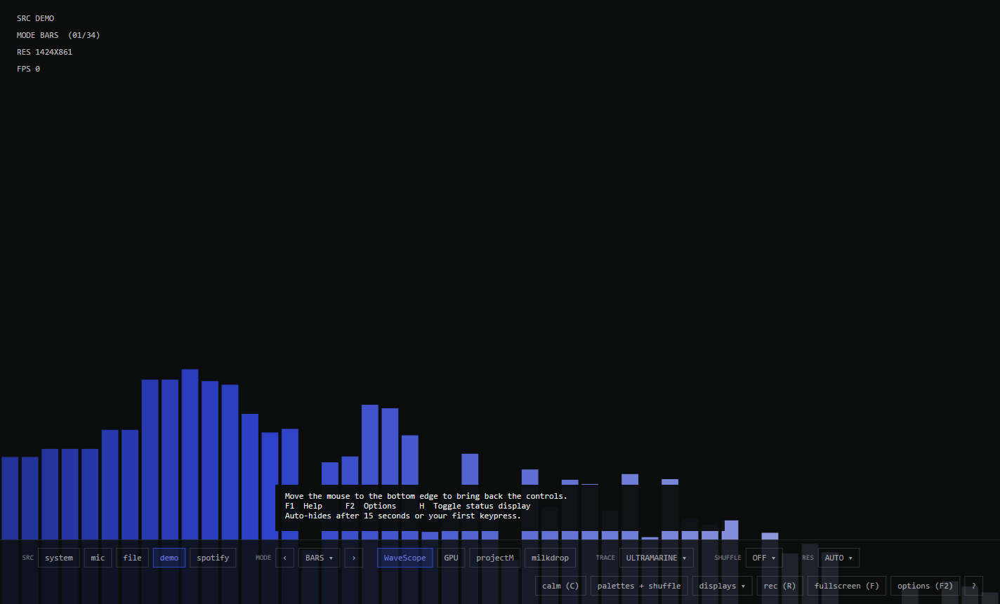
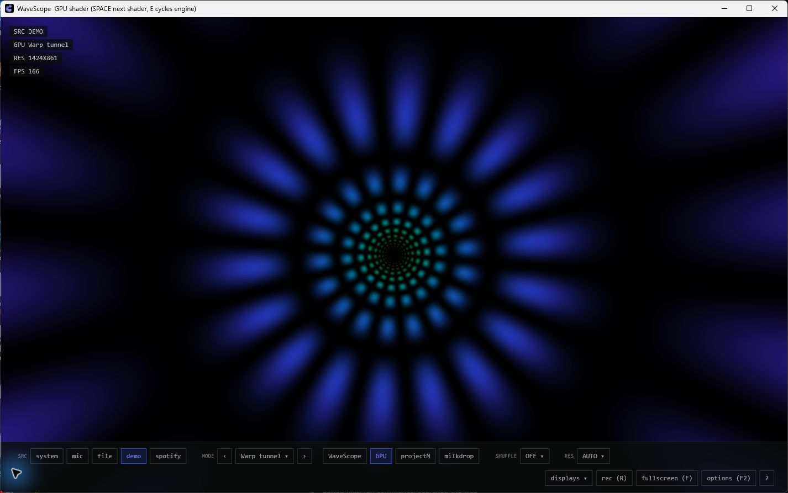
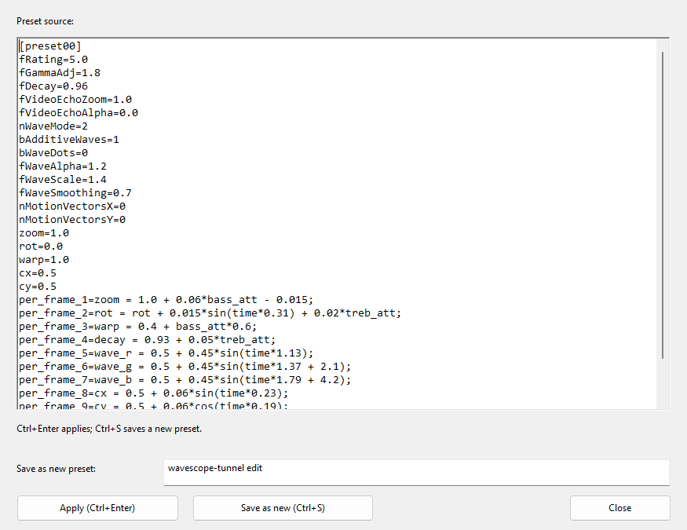

# WaveScope (native)

[](https://github.com/jasonulbright/wavescope-native/actions/workflows/ci.yml)
[](https://github.com/jasonulbright/wavescope-native/actions/workflows/release.yml)
[](https://github.com/jasonulbright/wavescope-native/releases/latest)
[](https://github.com/jasonulbright/wavescope-native/releases)
[](#get-it)
[](LICENSE)

A music visualizer built like an instrument, and built like a classic
Windows app: one C++ source tree, one statically linked exe, OS facilities
everywhere they exist, and exactly two deliberate dependencies — libprojectM
for real MilkDrop and the Spout SDK for OBS texture sharing, both pinned.
This is the native successor to the [WaveScope web app](https://wavescope.signalridgelabs.com)
([web source](https://github.com/jasonulbright/wavescope)). It shares the
web app's analysis math, 34 modes, 17 GPU shaders,
palettes, the same 15 `.milk` presets plus the full 551-preset classic
MilkDrop library in original form — and adds the things only a desktop app
can do: silent WASAPI loopback, MP4 clip recording, companion displays from
one engine, Spout output for OBS, always-on-top, tray, launch at login.



*Nebula on the demo signal. All screenshots are captured from the native app.*

## Get it

Choose a download from the [latest release](https://github.com/jasonulbright/wavescope-native/releases/latest):

| Download | Use it for |
| --- | --- |
| **Installer** — `WaveScope-v<version>-installer-win64.msi` | Install for your Windows account, with a Start menu shortcut, repair, upgrades, and removal through Settings → Apps. No administrator account is required. |
| **Portable** — `WaveScope-v<version>-portable-win64.zip` | Unzip anywhere, including a USB stick, and run `WaveScope.exe`. Settings, saved presets and recordings stay in that folder. |

Both packages include the projectM DLLs, their app-local VC++ runtime, both
preset libraries, the texture pack, documentation and third-party notices.
The installer uses `%LOCALAPPDATA%\Programs\WaveScope` for application files;
user data lives [separately](#persistence) and survives upgrade/uninstall.
Close WaveScope before upgrading or removing it. If you enabled launch at
login, run `WaveScope.exe remove-startup` before uninstalling or deleting it.

Requires Windows 10 version 1703 or newer (including Windows 11), x64, and
an OpenGL 3.3-capable graphics driver for the GPU and MilkDrop engines.
Official ZIPs starting with **v1.1.1** contain
timestamped signatures from **Jason Ulbright** on the app and projectM DLLs.
The MSI installer is also signed starting with **v1.2.0**. Versions before
1.1.1 and local builds are unsigned. Each download has its own SHA-256 checksum;
see [download verification](docs/RELEASING.md#verify-a-download).

Upgrading from a portable release is optional: you can keep using the ZIP.
To move to the installer, close the portable app, install, and copy its
`wavescope.ini` and `presets\user` to the matching paths under
`%LOCALAPPDATA%\WaveScope` before the first installed launch. Recordings can
be moved to `Videos\WaveScope`. A saved custom MilkDrop folder remains an
absolute path; select its new location if you move that folder. Keep the
portable copy until you have checked the migration.

## First launch

1. Start playing music in any app. WaveScope listens to your Windows default
   output; Spotify authorization is optional. Press **3** for a silent demo
   signal if you want to explore without playing music.
2. Move the mouse to the **bottom edge** to reveal the controls. Choose
   **GPU** for shader effects, **projectM** for the bundled WaveScope presets,
   or **milkdrop** for the classic library. Use **Space / → / ←** to browse.
3. Press **F** for fullscreen, **F1** for the keymap, and **F2** for Spotify
   Options. **H** toggles the status display; mouse movement wakes it while enabled.

Starting with **v1.2.1**, the controls and a discovery hint appear for **15 seconds
or until the first keypress** on launch. This release also adds the search/favorites
browser, pinned controls, native preset editor and audio player described below.



If the picture is quiet, try **3** first, then **1** to return to system audio.
For microphone input (**2**), check that the intended microphone is Windows'
default input. Minimizing hides WaveScope to its tray icon; double-click that
icon to bring it back. Use the tray's **Quit** command to exit.

## The three engines

| Engine | What it is |
|---|---|
| **WaveScope** | 34 built-in modes in five families (spectrum 9, waveform 6, particles 6, geometry 6, field 7), Direct2D, faithful ports of the web canvas math, phosphor-trail retained rendering. |
| **GPU** | All 17 web WGSL shader modes ported 1:1 to GLSL 330 (Plasma field … Scope lines), compiled at runtime on a WGL context. Audio uniforms plus per-frame FFT (1024×R8) and waveform (2048×R8) textures with `spec()/specLog()/wav()`. |
| **projectM / MILK** | Real MilkDrop via native libprojectM. PROJM plays the 15 bundled WaveScope presets (same files as the web app). MILK plays the **original classic library — 551 presets from the official MilkDrop distribution** (`presets-classic\`, with the shared texture pack in `textures\`) — or your own `.milk` folder (click the `milkdrop` deck button again to pick; the file list refreshes on change). These are the true originals of the ~60 converted classics the web's Butterchurn engine ships, running on the real ns-eel VM. |

<details>
<summary>See the GPU engine: Warp tunnel</summary>



</details>

## Sources

`1` system audio (WASAPI loopback — hears whatever the machine plays,
silently, no permission dialogs), `2` microphone, `3` demo signal
(oscillator bank + synthetic kick, analysis-only, matches the web spec),
`4` audio file (Media Foundation decode, audible, loop enabled initially). The capture
survives device unplugs and follows Windows default-device changes; silence
decays to dark instead of freezing.

Choosing a file opens the **Audio Player**; press **F5** or click the active
**file (F5)** deck button to reopen it. It shows the filename and elapsed/total
time, with **Pause/Play**, a seek bar and **Loop file**. Drag the bar and release
to seek, or use its arrow/Page Up/Page Down keys. Seeking while paused keeps it
paused. Turn Loop off to stop at the end; **Replay** starts it again. Closing
the player leaves playback running. **Ctrl+Space** pauses/resumes from the
visual or control windows; **Space** in the visual still advances the preset.
Seeking and looping are disabled when the decoder cannot provide duration or seek support.
Playback failures appear in the player; choose a file again to retry.

Analysis matches the web app's Web Audio analyser exactly — Blackman
window, |X|/N, 0.8 smoothing on linear magnitudes, [-100,-30] dB mapping,
Hz-based bands (250 Hz / 4 kHz splits) from the real device sample rate,
quarter-decimated RMS level, bass-flux beat envelope (1.35× gate, 0.08
floor, e^-6dt decay). Same music, same numbers, both apps.

## Keys

| Key | Action |
|---|---|
| `SPACE` / `→` | next mode / preset / shader |
| `←` | previous |
| `E` | cycle engine (WaveScope → GPU → projectM) |
| `G` | GPU shader engine |
| `F3` | preset browser: search, favorites, and favorites-only shuffle |
| `F4` | accessible native Controls window |
| `F5` | audio-file player: pause, seek, time and loop |
| `Ctrl+Space` | pause/resume audio-file playback |
| `Tab` / `Shift+Tab` | reveal and focus the on-screen deck; move between controls |
| Arrows / `Enter` while the deck is focused | move focus / activate; `Esc` leaves deck focus |
| `P` | cycle trace palette |
| `N` | palettes + shuffle panel (include list, 3-stop editor) |
| `1 2 3 4` | source: system / mic / demo / file picker |
| `M` | displays menu (move to a monitor, ALL DISPLAYS companions) |
| `R` | record clip → `wavescope-<timestamp>.mp4` (H.264 + AAC) |
| `O` | Spout output — OBS/Resolume ingest the visual as sender "WaveScope" |
| `B` | Spotify: authorize once + start playback (Premium) |
| `S` | shuffle timer (off / 15s / 30s / 1m / 5m / **DJ** / **VJ**) |
| `C` | calm mode (reduced beat intensity; excludes built-in burst modes) |
| `L` | preset lab — edit the active preset's `.milk`, apply, save |
| `T` | always on top |
| `F` | fullscreen — `H` HUD — `F1` / `?` help — `F2` options |
| `ESC` | close panel / menu / help / fullscreen, then quit |

Calm mode reduces some built-in effects. It is not a photosensitivity safety
guarantee; GPU shaders and MilkDrop presets can still flash.

Resolution targets (AUTO / 1080 / 1440 / 4K / 8K) live in the deck's
`RES ▾` dropdown; they drive the built-in modes' offscreen render. The GL
engines (GPU / projectM) always render at window size — fullscreen is
already native resolution — and the HUD's RES line reports the pixels
actually rendered either way. In the current source, the status display and control deck
stay visible for 15 seconds or until the first keypress, with a hint showing
how to find the controls again. That key still performs its normal action.
The deck reveals when the mouse nears the bottom edge and hides after 3 s idle;
`F1` opens the keymap and `F2` opens Options. Under GPU/projectM the trace-palette
controls hide (they color the built-in modes), web-style. DJ shuffle hops
engine AND visual every 30 s; VJ shuffle switches on the music itself — a
bass drop hard-cuts, a long lull morphs.

## MilkDrop: morph, lab, VJ

Use the deck's **pin** button or **F4 → Keep on-screen controls visible** to
disable auto-hide; this preference is saved. F4 exposes the same actions and
selectors through standard Windows buttons and combo boxes, with Tab,
Shift+Tab, arrow-key navigation and accessible control names. Rendering
continues while this window is open. Close it with Escape.

Click the projectM/MILK preset picker or press **F3** for the native preset
browser. Search filters filenames as you type; double-click a result or choose
**Play preset** to preview it while rendering continues. **Add favorite** saves
the selected preset, **Favorites only** filters the list, and **Shuffle favorites
in this library** limits timed shuffle and projectM automatic choices to that
library's favorites. An empty pool holds the current visual. Bundled favorites
survive moving a portable folder; external libraries use their full paths.

Under the projectM engine the deck grows a **MORPH** row: a target dropdown
(`shuffle`, or any preset in the library), a 0.5–10 s blend slider, and a
`morph` button that cross-fades from the playing preset to the target using
the engine's soft cut. Timed shuffle uses that same blend length, so preset
hops glide instead of cutting; `VJ` shuffle drops on the beat and morphs
through the lulls. The blend length is saved in `wavescope.ini`.

`L` (or the deck's `lab (L)` button) opens the **preset lab**, a resizable native
editor for the active preset's whole `.milk` source. It supports text selection,
copy/cut/paste, undo/redo and horizontal/vertical scrolling. `Ctrl+Enter` (or **Apply**)
recompiles it against the running signal; a syntax error keeps the previous
preset on screen and shows the engine's message. `Ctrl+S` (**Save as new**) writes the edit to
`presets\user\` inside your [data folder](#persistence) and switches the picker
to it. Save As requires a new filename and preserves an existing preset if
the name is reused. An asterisk marks unsaved text; closing the editor or app
offers save, discard or cancel. A failed save keeps editing open. Automatic
shuffle holds while the lab is open, while the visual continues rendering.
To point MILK at your own
`.milk` archive, click the `milkdrop` deck button again. The picker refreshes
when files are added or removed. External edits to the playing file take
effect when you select it again; the lab's **apply** button applies edits immediately.



## Recording

`R` (or the deck's `rec (R)` button) starts/stops an MP4 in `Videos\WaveScope`
for installed copies, or beside the exe for portable copies:
hardware H.264 where available plus AAC of the analysed audio, via Media
Foundation (no new dependencies). It captures the engine's render target
*before* the UI, at the current render resolution (built-ins) or window
size (GL engines), clamped to 4K — H.264 encoders stop near 4096 px a
side, so an 8K-target take lands as a 3840-wide file instead of failing.
The recording keeps its initial frame size: larger frames are cropped and
a smaller frame ends the take. Stop recording before changing engine,
resolution or window size to keep framing consistent.
`● REC mm:ss` shows in the HUD.

## OBS / Spout

`O` publishes the pre-UI visual as a Spout shared texture named
**WaveScope** — in OBS add a *Spout2 Capture* source (obs-spout2-plugin)
and pick it; Resolume/TouchDesigner see it the same way. This is the
desktop analog of the web app's `?embed=1` browser source, without the
browser. The state persists across launches. Implementation is the
vendored, pinned Spout SDK subset in `third_party/spout` (BSD-2-Clause;
see `PIN.md` there) — the frame feed reuses the recorder's capture path,
so the readback cost is only paid while the output is on. `selftest`
verifies the sender end-to-end with an in-process Spout receiver doing a
pixel roundtrip.

## Displays

`M` opens the displays menu: move the window to any monitor, or
**ALL DISPLAYS** to open a borderless companion on every other screen — all
driven by the one audio engine (one capture, one analysis; the web app
needs BroadcastChannel + PCM streaming for this). Each companion keeps its
own engine/mode/palette: focus it and use the normal keys; `Esc` closes
just that companion. `WaveScope.exe wall` boots straight into that state;
`kiosk` is a single borderless fullscreen with idle cursor-hide.

## Spotify

Open **Options (F2)** and enter the public **Client ID** from your own
Spotify application in the [developer dashboard](https://developer.spotify.com/dashboard). Register
`http://127.0.0.1:8888/callback` as its redirect URI. No bundled client ID,
client secret or API key is shipped. Leaving the ID blank or choosing
Disconnect clears the stored login. Changing the ID also clears tokens
issued to the previous app.

Press **B** (or the deck's Spotify button) to authorize with PKCE and resume
playback on an available device, preferring the active one. Playback control
requires Premium and your Spotify app must allow your account to sign in.
System loopback visualizes already-playing Spotify audio without any API setup.
The refresh token is encrypted with Windows DPAPI for the current user;
never distribute your personal `wavescope.ini` with a release.

## Persistence

| Files | Installed | Portable |
| --- | --- | --- |
| Settings and Spotify login | `%LOCALAPPDATA%\WaveScope\wavescope.ini` | `wavescope.ini` beside the exe |
| Saved lab presets | `%LOCALAPPDATA%\WaveScope\presets\user` | `presets\user` beside the exe |
| Recordings | Your Windows Videos folder → `WaveScope` | Beside the exe |

If Windows cannot locate Videos, installed recordings use
`%LOCALAPPDATA%\WaveScope\Recordings`. Installed copies contain an
`installed.flag` file; keep it in place so the app finds the correct data
folders. Portable ZIPs contain no such marker. Uninstall preserves user
data; remove the data folders yourself if you no longer want those files.

`wavescope.ini` stores mode, engine (incl. MILK library folder),
palette + custom palettes, resolution, shuffle (incl. include-list), calm,
window placement, and your Spotify sign-in (client ID + stored login, tied
to your Windows user account). The primary window's setup is what persists;
source intentionally resets to system audio each launch.

## Launch flags

`demo` · `file=<path>` · `milkdrop` · `shader` · `wall` · `kiosk` ·
`install-startup` / `remove-startup` (HKCU Run key, off by default) ·
`selftest`. Tray icon: right-click for Show/Hide, Always on top, Quit;
minimize hides to tray (and rendering fully stops while hidden).

## Product priorities

The first four priorities shipped in v1.2.1: preset
search/favorites, keyboard navigation and pinned controls, native editor
operations with unsaved-change protection, and audio-file playback controls.
The [product review](docs/PRODUCT-REVIEW.md) records their scope and validation.
Audio-device selection and recording feedback/destination controls remain
proposals for later work.

## Build

```
build.bat
```

Requires Visual Studio 2022 or 2026 with C++ desktop tools and a Windows SDK.
First [build the pinned projectM dependency](docs/RELEASING.md#build-dependency-from-the-pinned-source)
with the included PowerShell script. Set `PMROOT` to its `install-native`
directory; the default is `C:\projects\projectm\install-native`. The batch file:

1. builds and **runs the unit and adversarial tests** (`src/tests.cpp`) — a red test fails
   the build;
2. builds `WaveScope.exe` (`/MT`, no MSVC redistributable needed for the
   core app);
3. stages `projectM-4.dll` + `projectM-4-playlist.dll` beside the exe
   (these two need the VC runtime, present wherever VS or the VC redist is).

## Verify

```
WaveScope.exe selftest
```

Renders every engine on the demo signal and asserts real output: sweeps all
34 modes and all 17 shaders (17/17 must compile), records a 1.6 s MP4 and
re-opens/decodes it, does a Spout roundtrip through an in-process receiver,
sweeps a spread of the 551 classic presets through the ns-eel parser, dumps
PNGs of what actually rendered beside the exe, writes
`wavescope-selftest.log`, and exits nonzero on any failure. It also exercises
GUI layout/input, startup visibility, HUD re-enable, preset deletion/rejection,
lab redraw, morphing, VJ and recording restart regressions.
Run it on a Windows desktop after rendering or GUI changes. Selftest never
loads or writes personal settings or Spotify tokens.

## Package

`package.bat` builds (unit-test gate included), stages the portable layout
under `dist\`, runs the **staged** exe's selftest as the release gate — the
zip layout has to prove it runs standalone — and produces both
`dist\WaveScope-v<version>-portable-win64.zip` and
`dist\WaveScope-v<version>-installer-win64.msi`.

The packer includes only tracked preset/texture assets, excludes personal
presets and settings, and writes a SHA-256 checksum beside each download.
MSI packaging requires a .NET 8+ SDK and restores pinned WiX 5.0.2 tools.
`scripts/test-installer.ps1 -RunGraphicsTest` checks installation, repair,
the installed app, uninstall, and user-file preservation in an isolated
test folder. It refuses to run over an existing WaveScope installation.
Local packages are unsigned. The [signed release workflow](docs/RELEASING.md)
uses Azure Artifact Signing and prepares a draft for review. Its hosted
runner runs unit tests and builds the full package; the graphics selftest
must run on a Windows desktop with OpenGL 3.3 before release.

## Source map

- `src/analysis.inl` — the pure math shared with the tests: `AudioFrame`,
  HSL, `BinLog`, radix-2 FFT, `AnalyzeWindow` (the analyser contract).
- `src/main.cpp` — infrastructure: `AudioTap` (WASAPI loopback/mic thread,
  ring buffer, file playback, device-change + silence handling, per-consumer
  `ReadNew` cursors), `App` (window, D2D, deck/HUD/panel UI, engines,
  persistence), companion windows, tray, message loop.
- `src/viz_modes.inl` — palettes, `DrawCtx`, `VizState` (per-window mode
  state), all 34 modes.
- `src/shader_host.inl` — the GPU engine: WGL host, 17 GLSL ports, audio
  textures.
- `src/projectm_host.inl` — the MilkDrop engine host: WGL host, libprojectM,
  preset scan/sort/hot-reload.
- `src/spotify.inl` — the Spotify sign-in flow, local return listener,
  WinHTTP calls, stored login, now-playing poller.
- `src/spotify_helpers.inl` — callback parsing, encoding and Windows JSON helpers.
- `src/record.inl` — MP4 clip recorder (Media Foundation SinkWriter).
- `src/spout_out.inl` — Spout output wrapper (`third_party/spout`).
- `src/ui_paint.inl` — the abstract UI painter (one UI, every engine).
- `src/selftest.inl` — the `selftest` harness.
- `src/tests.cpp` and `src/security_tests.inl` — math, registry and adversarial
  protocol/configuration tests (run by `build.bat`).
- `src/options.inl` — native Spotify settings dialog.
- `src/preset_browser.inl` and `src/preset_favorites.inl` — search, favorites and shuffle filtering.
- `src/controls.inl` — accessible native controls and the saved deck pin.
- `src/lab_native.inl` — native rich-edit preset lab and unsaved-change guards.
- `src/audio_file.inl` and `src/audio_transport.inl` — file decoding/playback and the native player.
- `src/version.h` — release version shared by the app and Windows resources.
- `src/app_paths.inl` — installed/portable data locations and selftest isolation.
- `src/preset_save.inl` and `src/storage_tests.inl` — atomic Save As, filename
  validation and storage regression tests.
- `installer/WaveScope.wxs` — per-user MSI, shortcuts and upgrade behavior.

## Dependencies

OS facilities everywhere they exist (WinHTTP, Media Foundation, WASAPI,
D2D/DirectWrite/WIC, WGL, and DPAPI), plus two pinned dependencies:
libprojectM 4.x (LGPL-2.1, built from upstream source and linked dynamically)
and the Spout SDK's DX subset (BSD-2-Clause, vendored in-tree). Small ini and
base64url helpers have regression tests. Spotify JSON uses the Windows JSON
parser through the Windows SDK's C++/WinRT headers. See the
[review findings and limits](docs/ADVERSARIAL-REVIEW.md).

## Licensing

[MIT](LICENSE) © 2026 Signal Ridge Labs — same as the web app. Third-party:

- **libprojectM 4.x** — LGPL-2.1, satisfied by dynamic linking
  (`projectM-4.dll` ships beside the exe, never statically linked).
- **Spout SDK (DX subset)** — BSD-2-Clause, vendored verbatim with its
  license at `third_party/spout/LICENSE.txt` (pin in `PIN.md` there).
- **MilkDrop preset + texture packs** — community-distributed content,
  redistributed from the projectM-visualizer org (`presets-classic/` and
  `textures/`; the pack's own README ships alongside).

Full license texts and exact upstream pins live in
`THIRD-PARTY-NOTICES.txt` (repo root, and inside every release zip).
